# Economic Growth Prediction Project

## Project Overview
This project investigates the relationship between changes in nighttime light intensity and internet speeds, exploring their combined impact on economic development. Using data from Ookla (internet speeds) and VIIRS (nighttime radiance), the project focuses on three Brazilian cities (Rio de Janeiro, Bahia, and São Paulo) during 2019 and 2020. The findings aim to provide actionable insights into how digital infrastructure and urban activity influence regional economic growth.

## Project Structure
```
Economic-Growth-Prediction/
├── VIIRS_20/                    # VIIRS nighttime light data processing
│   ├── *.ipynb                  # City-specific data processing notebooks
│   ├── *.geojson               # Geographic boundary files
│   └── geoBoundaries-BRA-ADM1-all/  # Brazilian administrative boundaries
├── Ookla_20/                    # Ookla internet speed data processing
│   ├── Ookla_20_*.ipynb        # Data processing notebooks
│   ├── converter_shp_csv_ookla.ipynb  # Shapefile to CSV converter
│   └── aggregate_by_county_py.ipynb   # County-level aggregation
├── images/                      # Generated visualizations
│   ├── 19/                     # 2019 analysis visualizations
│   └── 20/                     # 2020 analysis visualizations
├── *.ipynb                     # Main analysis notebooks
├── *.csv                       # Processed and merged datasets
└── README.md                   # This file
```

## Data Sources

### VIIRS (Visible Infrared Imaging Radiometer Suite)
- **Source**: NASA Suomi NPP satellite
- **Data Type**: Nighttime light intensity (radiance values)
- **Coverage**: Global, 2019-2020
- **Resolution**: 15 arc-second (~500m at equator)
- **Purpose**: Proxy for urban activity and economic development

### Ookla Speedtest Intelligence
- **Source**: Ookla's global internet performance database
- **Data Type**: Internet speed measurements (download/upload speeds, latency)
- **Coverage**: Global, 2019-2020
- **Metrics**: 
  - `avg_d_kbps`: Average download speed in kilobits per second
  - `avg_u_kbps`: Average upload speed in kilobits per second
  - `avg_lat_ms`: Average latency in milliseconds
  - `tests`: Number of speed tests performed
  - `devices`: Number of unique devices

## Methodology

### 1. Data Collection and Preprocessing
- **VIIRS Data**: Downloaded and processed monthly composites for 2019-2020
- **Ookla Data**: Aggregated speed test data by geographic coordinates
- **Geographic Boundaries**: Used official Brazilian administrative boundaries

### 2. Data Integration
- **Spatial Joins**: Merged VIIRS and Ookla datasets using geographic coordinates
- **Temporal Alignment**: Aligned data by month and quarter
- **Quality Control**: Removed outliers and invalid measurements

### 3. Analysis Approach
- **Exploratory Data Analysis (EDA)**: Identified patterns and correlations
- **Statistical Analysis**: Conducted hypothesis testing and regression analysis
- **Geospatial Analysis**: Mapped economic hotspots and regional variations

## Key Findings

### Statistical Results
- **Pearson Correlation**: 
  - Light intensity vs. download speed: **0.41** (p < 0.05)
  - Statistically significant positive relationship

### Economic Insights
1. **Positive Correlation**: Regions with higher urban activity (nighttime lights) tend to have better digital infrastructure
2. **Economic Hotspots**: Areas with improved internet connectivity and urban development show stronger economic growth
3. **Regional Variations**: Significant differences between cities in terms of digital infrastructure and economic activity

## Visualizations

### 2019 Analysis
- Correlation heatmaps between light intensity and internet speeds
- Scatter plots showing relationships between variables
- Regional comparisons and top-performing areas
- Geospatial overlays of economic activity

### 2020 Analysis
- Updated visualizations with 2020 data
- Comparative analysis with 2019 results
- Enhanced heatmaps and scatter plots
- Regional performance rankings

### 2019 vs 2020 Visual Comparison
The following side-by-side comparisons show the same visualizations for 2019 and 2020:

| **Visualization** | **2019** | **2020** |
| --- | --- | --- |
| Heatmap | 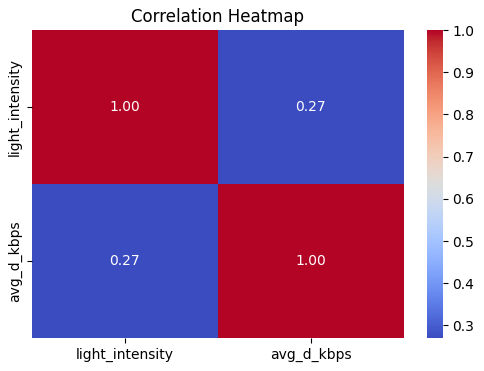 | 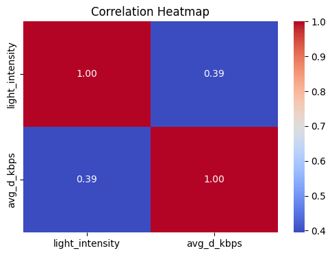 |
| Internet vs Light (scatter) | 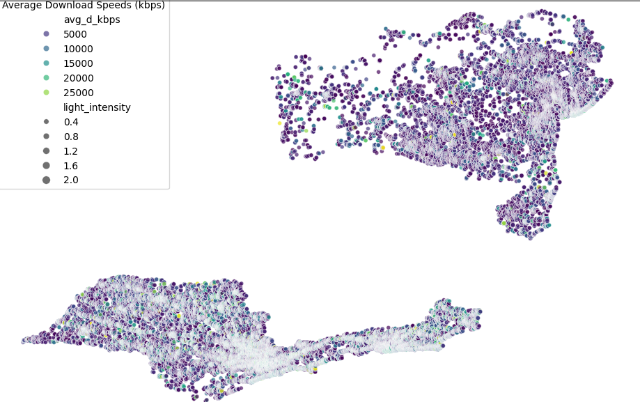 | 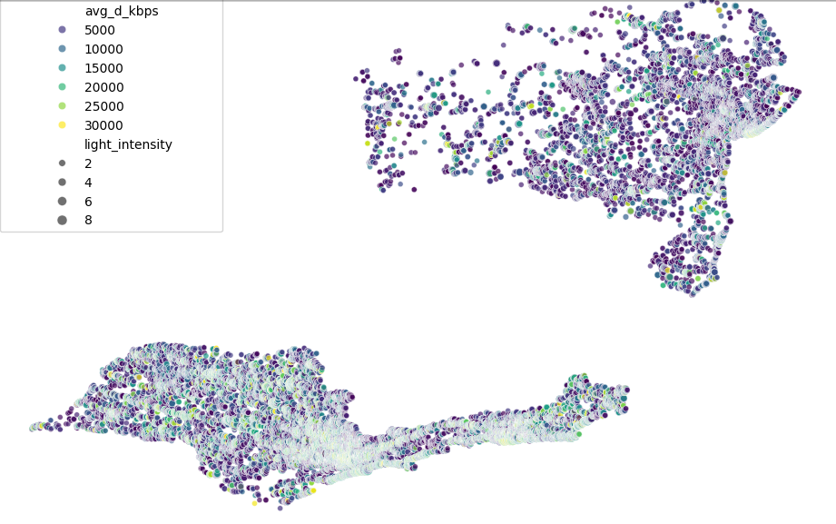 |
| Internet vs Light (low) | 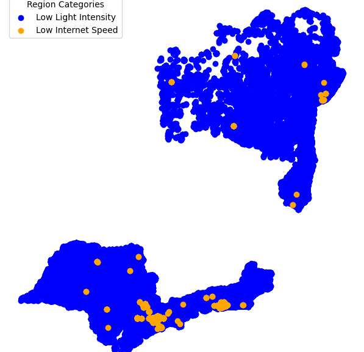 | 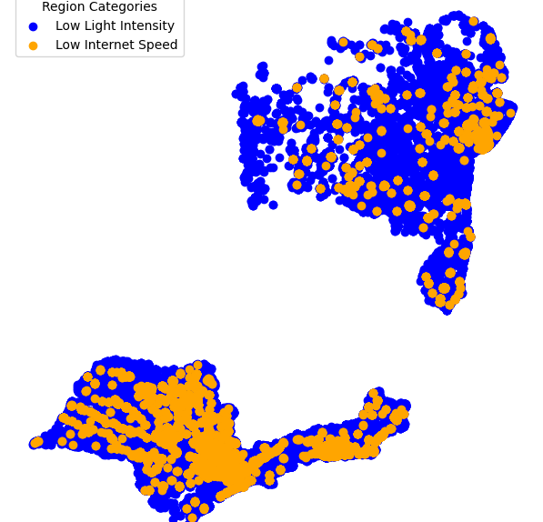 |
| Internet vs Light (high) | 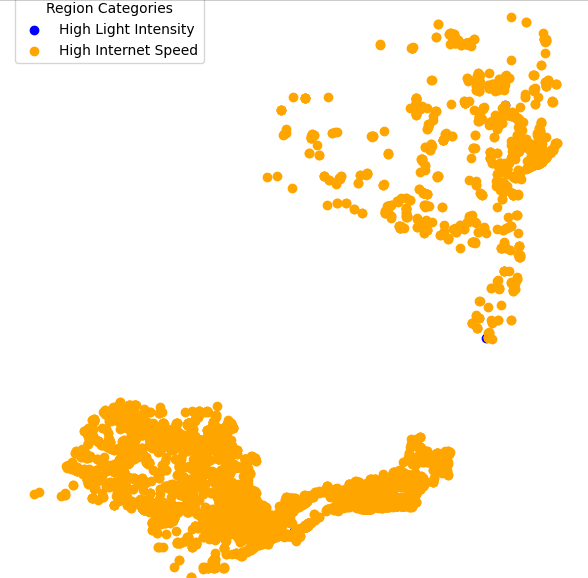 | 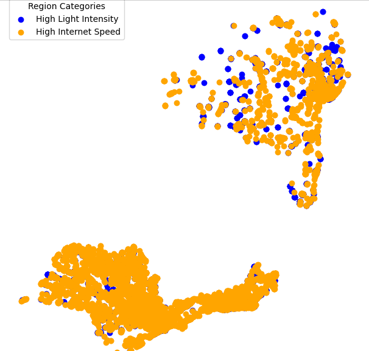 |
| Internet Low vs High | 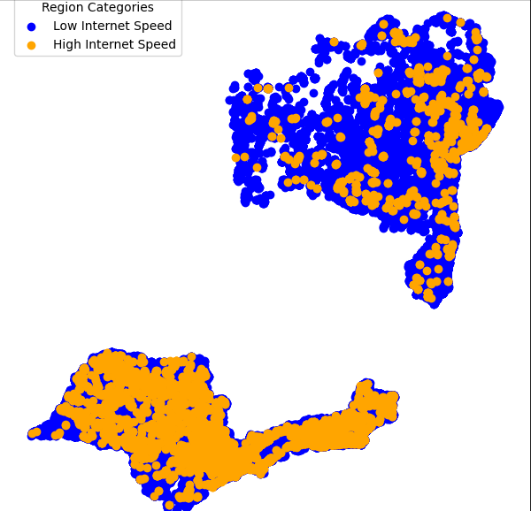 | 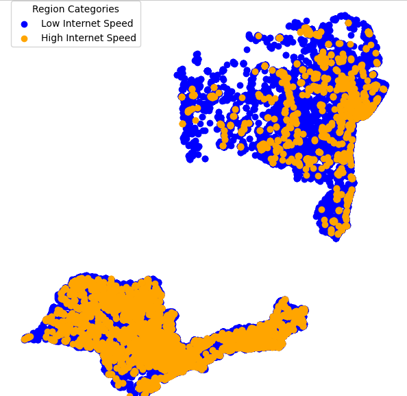 |
| Light Low vs High | 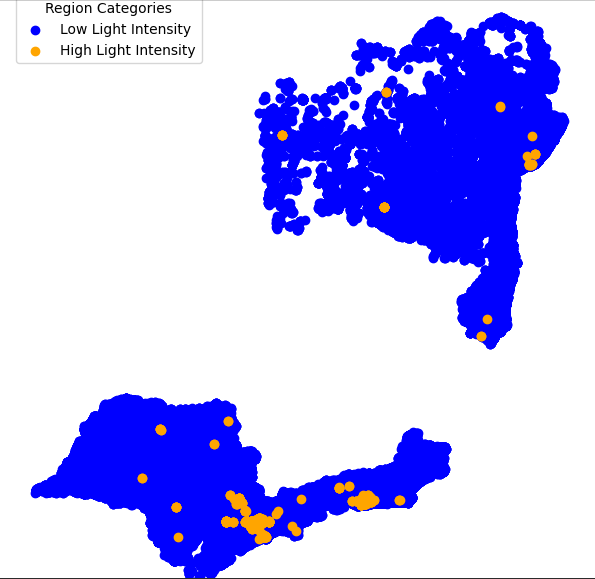 | 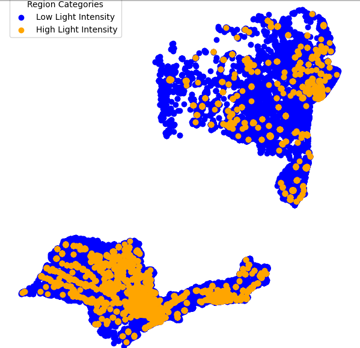 |
| Internet vs Light Relation | 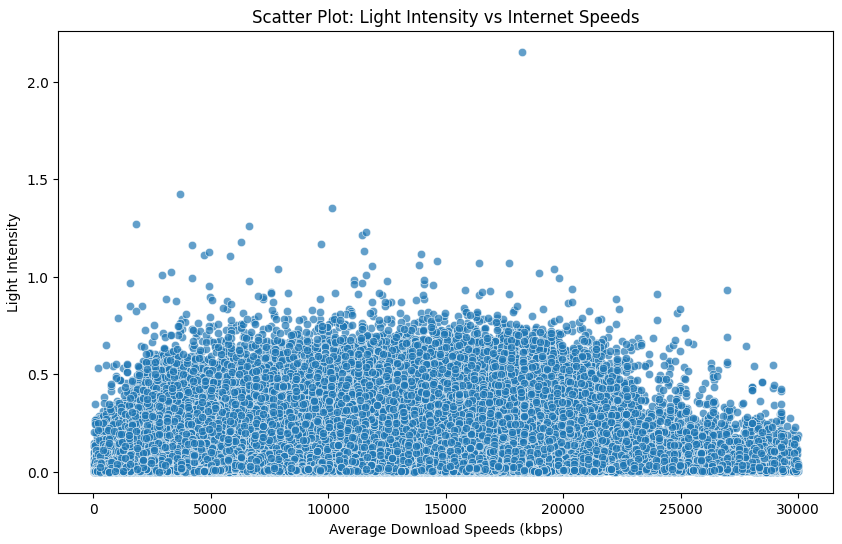 | 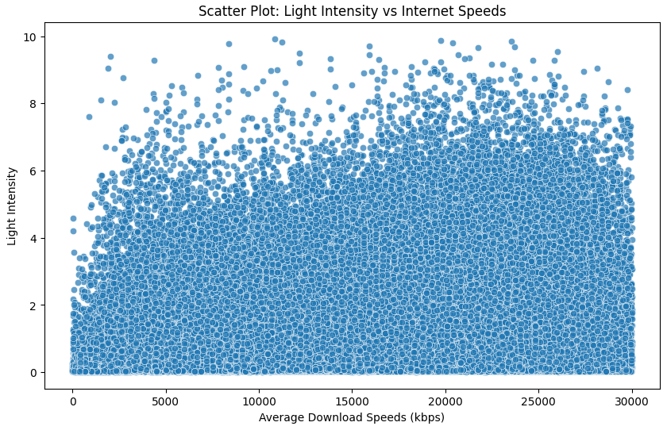 |
| Top 10 Regions | 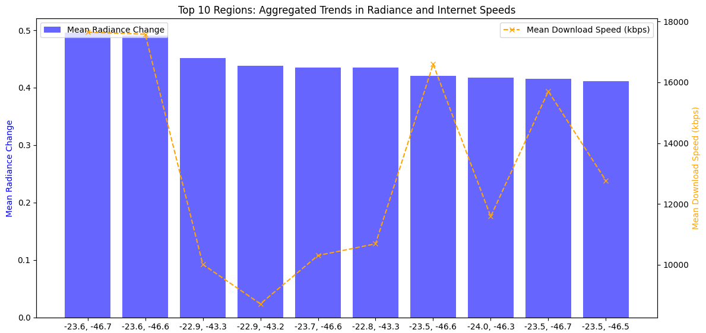 | 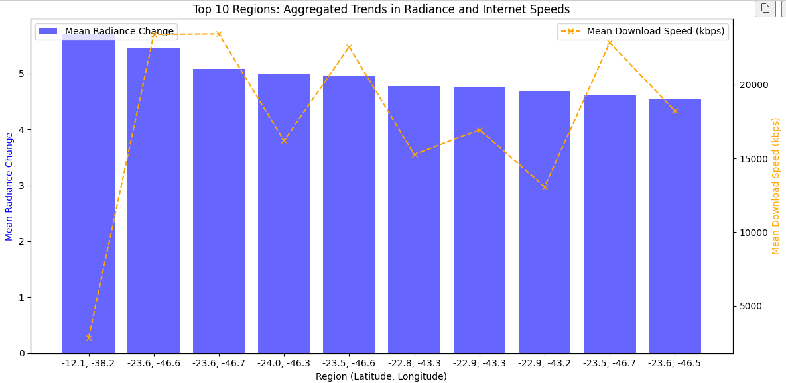 |

## Technical Implementation

### Technologies Used
- **Python**: Primary programming language
- **Pandas**: Data manipulation and analysis
- **GeoPandas**: Geospatial data processing
- **Matplotlib/Seaborn**: Data visualization
- **Jupyter Notebooks**: Interactive development and analysis

### Data Processing Pipeline
1. **Raw Data Collection**: Download from VIIRS and Ookla sources
2. **Data Cleaning**: Remove outliers, handle missing values
3. **Spatial Processing**: Geographic alignment and boundary matching
4. **Aggregation**: Summarize data by administrative regions
5. **Analysis**: Statistical testing and visualization
6. **Output**: Generate insights and visualizations

## Results and Impact

### Key Contributions
- **Methodology**: Novel approach combining satellite imagery with internet performance data
- **Economic Insights**: Quantitative evidence linking digital infrastructure to economic development
- **Policy Implications**: Guidance for infrastructure investment and urban planning

### Applications
- **Urban Planning**: Identify areas needing infrastructure investment
- **Economic Development**: Target regions with high growth potential
- **Policy Making**: Data-driven decisions for digital infrastructure
- **Research**: Foundation for further economic development studies

## Future Work

### Short-term Improvements
- Expand analysis to more Brazilian cities
- Include additional economic indicators (GDP, population density)
- Enhance visualization quality and interactivity

### Long-term Goals
- Develop predictive models for economic growth
- Extend analysis to other countries and regions
- Create real-time monitoring dashboard
- Integrate with additional data sources (demographics, infrastructure)

## Team

### Project Leadership
- **[Dr. Noha Gamal](https://www.linkedin.com/in/dr-noha-gamaleldin-383ab820/)** (Supervisor)

### Team Members
- **[Omar Elhossiny](https://www.linkedin.com/in/omar-elhossiny-530553261)**
- **[Abdelrahman Ahmed](https://www.linkedin.com/in/abdelrahman-ahmed-fouad/)**
- **[Sherif Ahmed Mahmoud](https://www.linkedin.com/in/sherif-ahmed-1a611b2aa/)**


## Getting Started

### Prerequisites
- Python 3.7+
- Jupyter Notebooks
- Required packages: pandas, geopandas, matplotlib, seaborn

### Installation
1. Clone the repository
2. Install required packages: `pip install -r requirements.txt`
3. Open Jupyter notebooks in the project directory

### Running the Analysis
1. Start with `EDA_19.ipynb` or `EDA_20.ipynb` for exploratory analysis
2. Review `merging_19_analysis.ipynb` or `merging_20_analysis.ipynb` for data processing
3. Explore city-specific notebooks in `VIIRS_20/` and `Ookla_20/` directories

## Data Access
The processed datasets and analysis notebooks are available in this repository. Raw data sources can be accessed through:
- **VIIRS**: [NASA Earth Data](https://earthdata.nasa.gov/)
- **Ookla**: [Speedtest Intelligence](https://www.ookla.com/speedtest-intelligence)

## License
This project is for educational and research purposes. Please ensure proper attribution when using the findings or methodology.

## Contact
For questions or collaboration opportunities, please contact the project team through the provided LinkedIn profiles.

